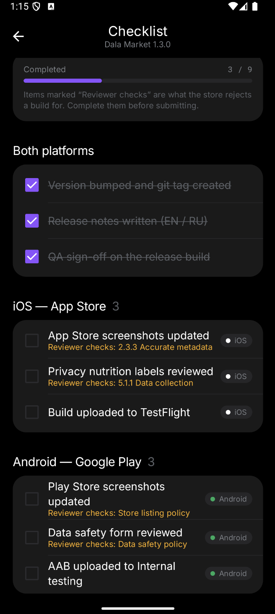
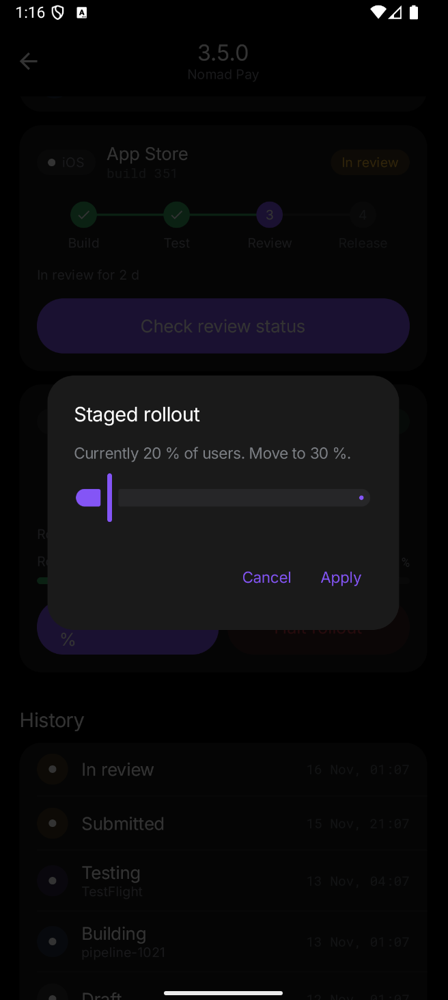
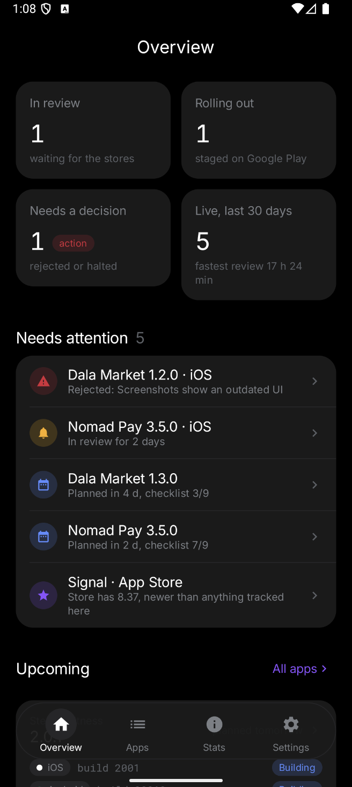
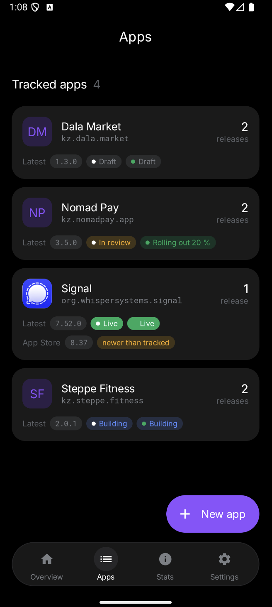
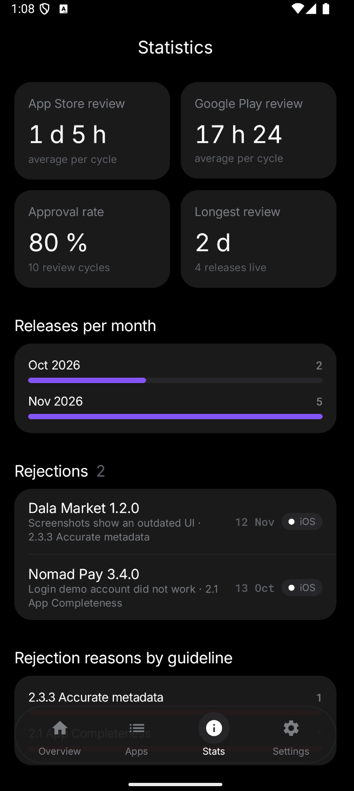
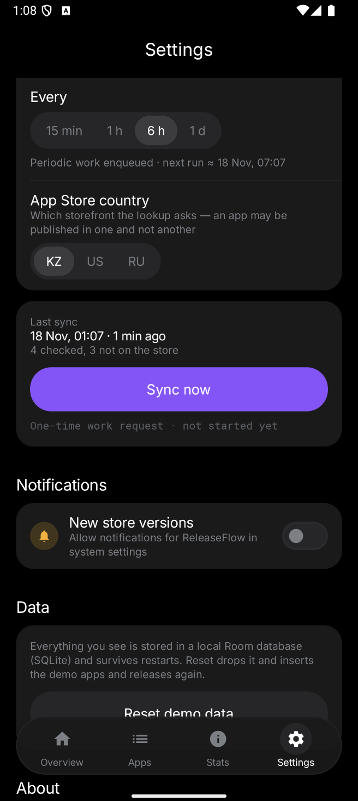
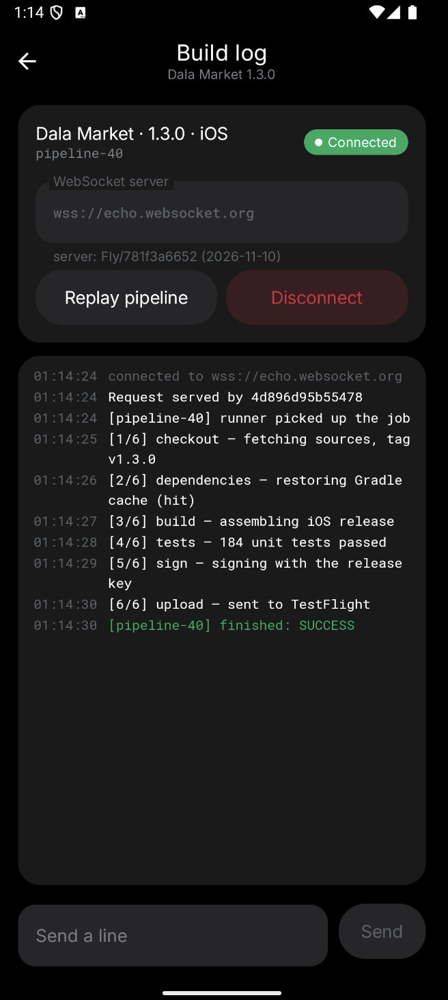

# ReleaseFlow — Endterm Project (Part 2) · HW4

Mobile Programming (KBTU, Fall 2026) · Android application with Kotlin, Jetpack Compose, Room, Retrofit,
WorkManager and DataStore. Continues the midterm project in [`../midterm-project`](../midterm-project)
and the Room edition submitted as Homework 3 in [`../hw3-mvvm-room`](../hw3-mvvm-room); the same codebase
is submitted for **Homework 4** (networking and background processing).

**ReleaseFlow** is a release tracker for mobile teams: where each app version is on each platform (CI →
TestFlight / Internal testing → store review → staged rollout → live), what the reviewer rejected and why,
what still has to be done before submitting, and how long reviews take. Part 1 built the workflow, the
screens and the design system on in-memory data. Part 2 turns it into a complete application:

| Syllabus requirement | What Part 2 adds |
| --- | --- |
| **Persistent data** | A **Room** database (6 tables with foreign keys and `ON DELETE CASCADE`) is the single source of truth; every screen is a `Flow` from the DAO. **Preferences DataStore** stores the settings. Data survives restarts; a reset restores the demo set. |
| **External APIs** | **Retrofit + kotlinx.serialization** against two public REST APIs: the **iTunes Search API** (live App Store version, rating, release notes, icon — compared with what is tracked) and the **GitHub Releases API** (import a repository's releases as tracked releases). An **OkHttp WebSocket** streams a live build log. Every call has loading / success / error / empty states. |
| **Modern application architecture** | MVVM with a **Repository** layer behind interfaces, **manual DI** through an `AppContainer` owned by the `Application`, per-screen ViewModels created by a `viewModelFactory` with `SavedStateHandle` for route arguments, immutable domain models, `StateFlow` everywhere. |
| **Background processing** | **WorkManager**: a periodic store-sync worker (network + battery constraints, `ExistingPeriodicWorkPolicy.UPDATE`) and a one-time "Sync now" request; the worker posts a **notification** when a store version changes; its `WorkInfo` state is shown live on the Settings screen. |

## Features

| Feature | What the release manager can do |
| --- | --- |
| **Release workflow per platform** (Part 1) | Each release has an iOS and/or Android track with the stages `Draft → Building → Testing → Submitted → In review → Approved / Rejected → Rolling out → Live` (`Halted` for a paused rollout). The domain decides which actions are allowed; Android supports staged rollout. |
| **Submission checklist** (Part 1) | Generated per release; items mapped to a store guideline decide the outcome of the simulated review. |
| **App Store listing** (new) | For every app, the live App Store entry: version, release date, rating, "What's new", icon, seller. A pill compares the store version with the newest version shipped from ReleaseFlow (*matches / newer than tracked / older*). Cached in Room, refreshed by hand or by the background worker. |
| **Apps and releases CRUD** (new) | Create, edit and delete apps and releases through forms with validation (unique name / version, bundle-id and date formats); deletions ask for confirmation and cascade through the database. |
| **New app with lookup** (new) | Type a bundle id, tap **Look up**: the iTunes API fills the name and shows the listing before the app is saved. Unknown ids are a state, not an error ("Not on the App Store"). |
| **GitHub releases** (new) | Link a public repository to an app and browse its releases (tag, name, date, author, pre-release/draft, assets and downloads, notes) with pull-to-refresh. **Track 7.60.0** imports a release as a tracked release; already-tracked versions link to their release. |
| **Live build log** (new) | While a track is *Building*, a WebSocket connection streams the pipeline's log lines; a line can be pushed through the socket by hand. |
| **Settings** (new) | Background sync on/off and interval, App Store storefront (KZ/US/RU), notifications (asks for the Android 13 permission), **Sync now** with the live WorkManager status and the last sync summary, reset of the demo data. |
| **Dashboard, statistics** (Part 1 + ) | The attention list now also shows store versions that are newer than anything tracked. |

## Screens and navigation

```
Overview ──────────── release/{id} ──┬── release/{id}/checklist
                                     ├── release/{id}/edit
Apps ──┬─ apps/new ──► app/{id}      └── release/{id}/log/{platform}   (WebSocket)
       └─ app/{id} ──┬── app/{id}/edit
                     ├── app/{id}/new ──► release/{id}
                     ├── app/{id}/github                              (REST: GitHub)
                     └── release/{id}
Stats
Settings
```

Four top-level destinations in the floating tab bar; the detail routes carry typed arguments
(`Int` ids, the platform as a `String`) that the per-screen ViewModels read from their `SavedStateHandle`.

## Screenshots

The additional feature is the **release workflow** — status transitions with conditions, decided by the
domain and persisted in Room. Every badge, button and number below is derived from the stored stage history:

| Submission checklist decides the review | Staged rollout — a conditional transition | Overview — attention list driven by the workflow |
| --- | --- | --- |
|  |  |  |

*Checklist (Dala Market 1.3.0):* items marked "Reviewer checks" are bound to store guidelines; while one of
them is unchecked, "Check review status" ends in `Rejected` citing that guideline. Ticking a box is a Room
update (`toggleChecklistItem`) and the progress bar, the release card and the overview recompute from the
Flow. *Rollout (Nomad Pay 3.5.0, Android):* `Rolling out 20 %` can only move up, in steps the slider
constrains, and only on Google Play — iOS has no staged rollout, so its track never shows this action.
*Overview:* a rejected iOS review and a review waiting for two days surface as "Needs attention"; the
Signal row comes from the App Store lookup (the store has 8.37, newer than the tracked 7.52.0).

| Apps — per-platform stage of every release | Statistics — review times, approval rate, rejections | Settings — WorkManager status, DataStore preferences | Build log — WebSocket stream |
| --- | --- | --- | --- |
|  |  |  |  |

*Apps:* `In review`, `Rolling out 20 %`, `Building`, `Draft`, `Live` are the current stages of each
platform track, i.e. the last row of its `stage_events`. *Statistics:* average review per store, 80 %
approval over 10 review cycles and the rejection log by guideline, computed from the same rows.
*Settings:* the periodic store-sync request is enqueued with its next run time; the last manual sync
checked 4 apps (3 are not on the App Store — the demo apps); interval and storefront are DataStore
preferences. *Build log:* the pipeline steps streamed back over an OkHttp WebSocket.

## How to run

1. Android Studio Ladybug (2024.2) or newer with **Android SDK Platform 35**.
2. `File → Open…` → this folder (`endterm-project`). Wait for the Gradle sync (Gradle 8.13, AGP 8.13).
3. Start an emulator (API 26+) with **internet access** or connect a device and press **Run ▶**.

```bash
./gradlew assembleDebug   # app/build/outputs/apk/debug/app-debug.apk
./gradlew installDebug
```

The first launch seeds the database: three fictional apps with six releases in different states and one
real open-source app (**Signal**, `org.whispersystems.signal`, `signalapp/Signal-Android`) so that the App
Store lookup and the GitHub list show live data.

Suggested walk-through: **Apps → Signal → Refresh** (REST call, listing appears and is cached) →
**GitHub releases** (list from the API, pull to refresh, *Track* the newest tag) → the new release
opens from the app → **Start build → Live build log** (WebSocket) → **Settings → Sync now** (WorkManager
runs, status changes `ENQUEUED → RUNNING → SUCCEEDED`, a notification arrives) → kill the app and reopen:
everything is still there (Room). Then **Apps → New app**, type `ph.telegra.Telegraph`, **Look up**.

## Architecture

```
┌──────────────── UI ────────────────────┐   ┌──────────────── data ─────────────────┐   ┌──── domain ────┐
│ MainActivity                           │   │ ReleaseRepository ◄─ OfflineRelease-  │   │ (pure Kotlin)  │
│  └ ReleaseFlowApp (Scaffold + NavHost) │   │   Repository ── Room: ReleaseDatabase │   │ ReleaseStage   │
│     screens/*  components/*            │◄──│ StoreRepository ◄─ NetworkStore-      │◄──│ Release, Track │
│ ReleaseViewModel (shared)              │   │   Repository ── Retrofit: iTunes,     │   │ ReleaseService │
│ AddApp / AppDetails / GitHubReleases / │   │   GitHub · BuildLogSocket (WebSocket) │   │ ReleaseStats   │
│ BuildLog / Settings ViewModels         │   │ SettingsRepository ── DataStore       │   │ StoreGateway   │
│ AppViewModelProvider (factory)         │   │ work/: StoreSyncWorker, SyncScheduler │   └────────────────┘
└────────────────────────────────────────┘   └───────────────────────────────────────┘
                 ▲                                            ▲
                 └──────── ReleaseFlowApplication.container (AppContainer, manual DI) ────────┘
```

- **Domain** (`domain/`): unchanged rules, but the models became immutable `data class`es — with a
  database as the source of truth every object the UI sees is a snapshot of rows, so `ReleaseService`
  now returns *decisions* (`Transition`) and the repository persists them.
- **Room** (`data/local/`): `AppEntity`, `ReleaseEntity`, `TrackEntity`, `StageEventEntity`,
  `ChecklistItemEntity`, `StoreListingEntity`; nested `@Relation`s (`ReleaseWithDetails` →
  `TrackWithEvents`) read in `@Transaction`; an abstract `ReleaseDao` with `Flow` queries, `suspend`
  writes and a transactional `insertReleaseGraph`. A track's stage is the last row of its history —
  the schema cannot disagree with the domain. `Mappers.kt` encodes the sealed `ReleaseStage` as
  `stage / detail / extra` columns.
- **Repositories** (`data/repository/`): `ReleaseRepository` (interface) ← `OfflineReleaseRepository`
  (Room); `StoreRepository` ← `NetworkStoreRepository` (Retrofit, caches listings in Room);
  `SettingsRepository` (DataStore). Network errors propagate as `IOException` / `HttpException` and
  are turned into UI states by the ViewModels.
- **Network** (`data/remote/`): one `OkHttpClient` (timeouts, logging in debug, User-Agent), two
  Retrofit instances, `@Serializable` DTOs with defaults and `ignoreUnknownKeys`, and `BuildLogSocket`,
  a WebSocket wrapped in a `callbackFlow` that closes the socket when the collector is cancelled.
- **Background** (`data/work/`): `StoreSyncWorker : CoroutineWorker` reads the container from the
  `Application`, refreshes every listing, records a summary in DataStore, notifies on new versions and
  returns `retry()` when the network failed; `SyncScheduler` owns the unique periodic and one-time
  requests and exposes their `WorkInfo` as `Flow`.
- **UI** (`ui/`): the shared `ReleaseViewModel` collects `ReleaseRepository.data` once; screens with
  network state of their own have a ViewModel scoped to their back-stack entry
  (`viewModel(factory = AppViewModelProvider.Factory)`) and read arguments from `SavedStateHandle`.
  Navigation after a "create" is a one-shot `NavigationEvent` in the state, emitted once Room has
  delivered the new row.

## Homework 4 and endterm — where the requirements are demonstrated

| Requirement | Where |
| --- | --- |
| Room: entities, DAO, database, relations | `data/local/Entities.kt`, `ReleaseDao.kt`, `ReleaseDatabase.kt` |
| CRUD | **C** `insertApp`, `insertReleaseGraph`, `insertChecklistItem`; **R** `observe*` Flows, `app(id)`, `release(id)`; **U** `updateApp` (Edit app), `updateRelease` (Edit release), `toggleChecklistItem`, `updateGithubRepo`, `upsertListing`; **D** `deleteApp`, `deleteRelease`, `deleteAllApps` (Reset demo data) — all reachable from the UI |
| Room `Flow` → ViewModel → Compose | `OfflineReleaseRepository.data` = `combine(observeApps, observeReleases, observeListings)` → `ReleaseViewModel.uiState` → `collectAsStateWithLifecycle()` |
| Repository pattern, MVVM | `data/repository/*` interfaces + implementations; ViewModels never see Room or Retrofit types |
| Retrofit + data classes + coroutines | `data/remote/ItunesApi.kt`, `GitHubApi.kt` (`suspend` endpoints, `@Serializable` DTOs), `Network.kt` |
| Loading / success / error states in LazyColumn | `GitHubReleasesScreen` (`GitHubListState`), `AddAppScreen` (`LookupState`), `AppDetailsScreen` (`StoreRefreshState`) |
| API behind Repository and ViewModel, not called from the UI | `NetworkStoreRepository` → `AddAppViewModel`, `AppDetailsViewModel`, `GitHubReleasesViewModel`, `StoreSyncWorker` |
| WorkManager with constraints, one-time and periodic | `data/work/SyncScheduler.kt` (`NetworkType.CONNECTED`, `setRequiresBatteryNotLow`, `PeriodicWorkRequest` 15 min–24 h, `OneTimeWorkRequest` "Sync now"), `StoreSyncWorker.kt` |
| Notifications | `data/work/Notifications.kt` (channel, `POST_NOTIFICATIONS` runtime request in `SettingsScreen`) |
| WebSockets | `data/remote/BuildLogSocket.kt`, `BuildLogViewModel`, `BuildLogScreen` |
| DataStore | `data/repository/SettingsRepository.kt`, `SettingsScreen` |
| Dependency injection | `di/AppContainer.kt`, `ReleaseFlowApplication`, `ui/AppViewModelProvider.kt` |
| Configuration changes | ViewModels keep network results and socket connections; `SavedStateHandle` keeps route arguments; `rememberSaveable` keeps dialogs and drafts |

## Design system

Unchanged from Part 1 (`ui/theme`, `ui/components`): semantic palette in a `CompositionLocal`, flat
cards, pills, Inter / Roboto Mono, floating tab bar. New reusable components: `StoreListingCard`,
`StoreEmptyCard`, `StoreArtwork` (Coil), `AppSwitch`, `ConfirmDialog`.
