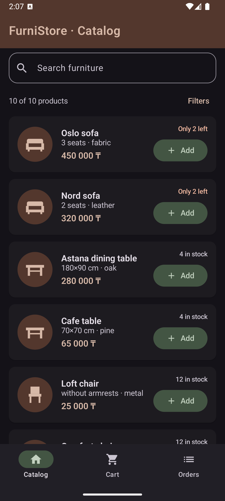
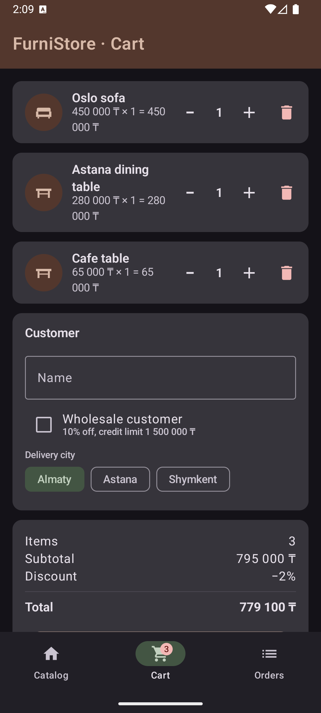
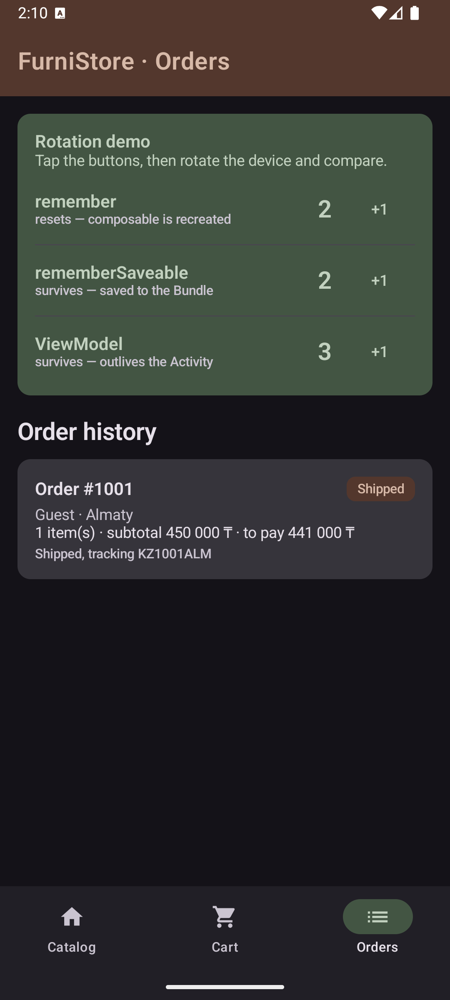

# HW2 — FurniStore: Android Application with Jetpack Compose

Mobile Programming (KBTU, Fall 2026) · Homework #2: Kotlin + Jetpack Compose + ViewModel.

**FurniStore** is a small furniture-store app that continues the [HW1 console project](../hw1-kotlin-oop/):
the same domain model (product hierarchy, orders, inventory, discount rules, suspend-based
payment and shipping) now drives a Material 3 user interface.

## Features

- **Catalog** — product list with search, material filter chips and an "in stock only" switch;
  every card shows stock level and an *Add* button that respects the warehouse quantity.
- **Cart** — quantity steppers, remove button, a customer form (name, wholesale checkbox,
  delivery city), live discount calculation using the HW1 rules (wholesale 10 %, 5+ items 5 %,
  Almaty 2 %, capped at 25 %) and a checkout with a confirmation dialog.
- **Checkout flow** — the order is placed, paid and shipped by `suspend` functions in a
  coroutine (`viewModelScope`); the button shows a progress indicator meanwhile, then the app
  switches to the Orders tab and shows a snackbar. Wholesale orders above 1 500 000 ₸ are
  declined by the "payment gateway" and the reserved stock is released.
- **Orders** — history with colored status badges (`Shipped`, `Cancelled`, …) and a
  **Rotation demo** card with three counters (`remember`, `rememberSaveable`, `ViewModel`).

## Screenshots

| Catalog with filters | Cart and checkout | Orders and rotation demo |
| --- | --- | --- |
|  |  |  |

## How to run

1. Install [Android Studio](https://developer.android.com/studio) (Ladybug 2024.2 or newer) with
   **Android SDK Platform 35** (SDK Manager → SDK Platforms).
2. `File → Open…` and choose this folder (`hw2-compose`). Wait for the Gradle sync to finish —
   the wrapper downloads Gradle 8.9 and all dependencies on the first run.
3. Start an emulator (API 26+) or connect a device, then press **Run ▶**.

Command line alternative:

```bash
./gradlew assembleDebug            # builds app/build/outputs/apk/debug/app-debug.apk
./gradlew installDebug             # installs it on the running emulator/device
```

## Project structure

```
app/src/main/java/kz/kbtu/furnistore/
├── MainActivity.kt                 single Activity; setContent { FurniStoreTheme { FurniStoreApp() } }
├── domain/                         business logic carried over from HW1 (no Android imports)
│   ├── model/Product.kt            interfaces, abstract Product, Sofa/Table/Chair/Wardrobe, Material enum
│   ├── model/Order.kt              Customer & OrderItem data classes, sealed OrderStatus, Order
│   ├── store/Inventory.kt          stock map, reserve/release, higher-order find()
│   ├── service/OrderService.kt     discount rules (lambdas), suspend processPayment/ship/fulfil
│   ├── util/Format.kt              Double.tenge(), Double.percent()
│   └── SampleData.kt               demo catalog and initial stock
└── ui/
    ├── StoreUiState.kt             immutable screen state + derived values (visible products, totals)
    ├── StoreViewModel.kt           StateFlow<StoreUiState>, all event handlers, checkout coroutine
    ├── FurniStoreApp.kt            Scaffold, TopAppBar, NavigationBar with cart badge, snackbar
    ├── screens/                    CatalogScreen, CartScreen, OrdersScreen
    ├── components/                 reusable composables (see table below)
    └── theme/                      Material 3 color scheme, typography, FurniStoreTheme
```

## Where the requirements are demonstrated

| Requirement | Where |
| --- | --- |
| Kotlin + Jetpack Compose | whole `ui/` package; `MainActivity.setContent` |
| Material 3 components, consistent styling | `ui/theme/` (custom `lightColorScheme`/`darkColorScheme`, `Typography`); `Scaffold`, `TopAppBar`, `NavigationBar`, `ElevatedCard`, `Card`, `FilterChip`, `OutlinedTextField`, `FilledTonalButton`, `Switch`, `Checkbox`, `AlertDialog`, `Snackbar`, `Badge` |
| Meaningful interface | catalog → cart → order flow of a furniture store |
| ≥ 3 reusable composables | `ProductImage`, `ProductCard`, `SearchField`, `MaterialFilterRow`, `QuantityStepper`, `CartItemRow`, `OrderStatusBadge`, `EmptyState`, `StateDemoCard` — all stateless, all with a `modifier` parameter |
| `Row`, `Column`, `Box` | `ProductCard` (Row of image + two Columns), `ProductImage` (Box stacking circle and `Image`), `FurniStoreApp` (Box for screen content), every screen |
| `LazyColumn`, `Card`, `Text`, `Image` | `CatalogScreen` / `CartScreen` / `OrdersScreen` use `LazyColumn`; `ProductImage` uses `Image(painterResource(...))` with vector drawables in `res/drawable/` |
| ≥ 2 user interactions | searching, filtering by material, in-stock switch, adding to cart, changing quantity, removing, editing customer data, selecting city, checkout |
| Input components | `OutlinedTextField` (search, customer name), `Button`/`FilledTonalButton`/`TextButton`/`IconButton`, `Checkbox` (wholesale), `Switch` (in stock only), `FilterChip` (materials, city) |
| UI updates in response to actions | every event goes `UI → ViewModel method → new StoreUiState → StateFlow → recomposition` |
| `remember` / `rememberSaveable` | `remember { SnackbarHostState() }`, `rememberLazyListState()`, `remember { mutableIntStateOf(0) }` in `StateDemoCard`; `rememberSaveable` for the filter panel (`CatalogScreen`), the confirmation dialog (`CartScreen`) and the second demo counter |
| ViewModel for state and logic | `StoreViewModel` — the only owner of catalog, cart, filters, orders, selected tab |
| UI separated from state management | composables receive `StoreUiState` + callbacks and never mutate anything; `StoreUiState` is an immutable `data class`, the ViewModel publishes new copies with `MutableStateFlow.update` |
| State during Activity recreation | see next section and the **Rotation demo** card on the Orders tab |

## What happens on rotation (Activity recreation)

Rotating the device destroys and recreates `MainActivity` and, with it, the entire composition.
The app deliberately does **not** set `android:configChanges`, so this really happens. The
Orders tab has a card with three counters to show the difference:

| Mechanism | Where the value lives | After rotation | After process death |
| --- | --- | --- | --- |
| `remember { mutableStateOf(…) }` | in the composition (memory of the current UI tree) | **lost** — the tree is rebuilt from scratch | lost |
| `rememberSaveable { mutableStateOf(…) }` | in the composition **and** in the Activity's saved-instance `Bundle` | **kept** — restored from the Bundle | kept (for Bundle-serializable types) |
| `ViewModel` (`StoreViewModel`) | in the `ViewModelStore`, which the system retains across configuration changes | **kept** — `viewModel()` returns the same instance | lost, unless `SavedStateHandle` is used |

In practice: the cart, filters, orders and selected tab survive rotation because they live in the
ViewModel; the open/closed state of the filter panel and the checkout dialog survive because they are
`rememberSaveable`; the list scroll position survives because `rememberLazyListState()` is saveable
internally; the first demo counter resets because it is a plain `remember`.

Rule of thumb used in the app: `remember` for cheap, transient UI objects that can be recreated;
`rememberSaveable` for small pieces of UI state the user would notice losing; `ViewModel` for
anything that is *application* state or needs logic (and coroutines) behind it.
