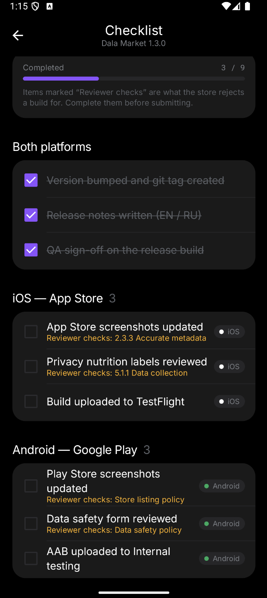
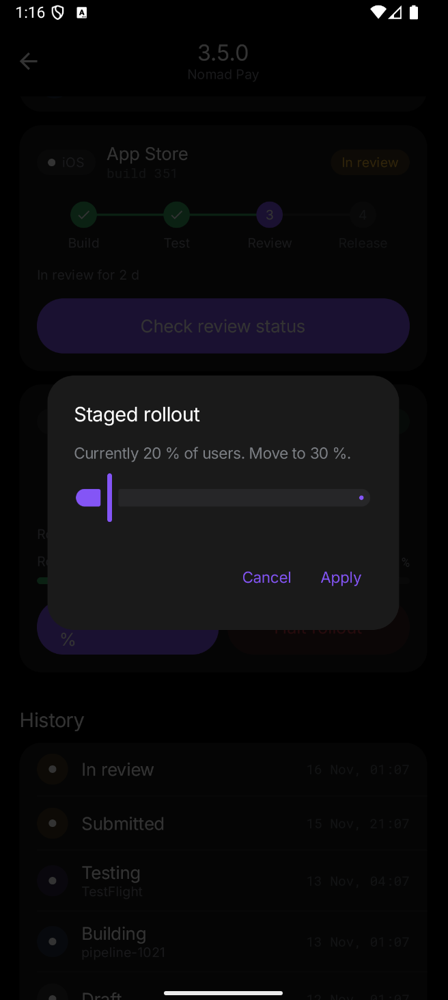
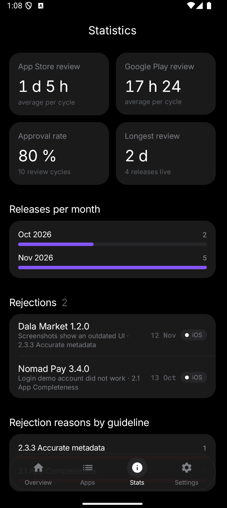

# HW3 — ReleaseFlow: MVVM and local data storage

Mobile Programming (KBTU, Fall 2026) · Homework #3: MVVM architecture, Room, CRUD and an advanced feature
on top of the [midterm project](../midterm-project/).

**ReleaseFlow** is a release tracker for mobile teams: where each app version is on each platform
(CI → TestFlight / Internal testing → store review → staged rollout → live), what the reviewer rejected
and why, what still has to be done before submitting. The midterm version kept everything in memory;
this version puts it in a **Room** database behind a **Repository**, adds the missing halves of CRUD
(edit forms, confirmed deletes) and keeps the midterm's additional feature — the **release workflow**
with status transitions and conditions — now persisted row by row.

The full endterm version with networking and background processing (HW4) lives in
[`../endterm-project`](../endterm-project/); this folder is the HW3 scope only, so it builds without
network permissions and without any API dependency.

## Features

| Feature | What the user can do |
| --- | --- |
| **Apps — full CRUD** | Apps list (`LazyColumn`, keyed by id) → app details → *New app* form with inline validation and a database uniqueness check → *Edit* form pre-filled from the database → *Delete* with a confirmation dialog (cascades to releases, tracks, history, checklists). |
| **Releases — full CRUD** | Releases of an app (keyed by id) → release details → *New release* form (version `1.2(.3)`, unique within the app; platforms; build numbers; ISO planned date) → *Edit* form (version, date, notes) → *Delete* with confirmation. |
| **Release workflow** (additional feature) | Each release has an iOS and/or Android track with the stages `Draft → Building → Testing → Submitted → In review → Approved / Rejected → Rolling out → Live` (`Halted` for a paused rollout). The domain decides which actions exist from each stage on each platform — Android gets a staged rollout with a percentage slider that can only go up, iOS releases in one step. CI and store checks are `suspend` calls with latency and a spinner. |
| **Checklist that decides the review** | Every release gets a generated submission checklist; items bound to a store guideline decide the outcome of "Check review status": an unchecked one means `Rejected` citing that guideline. Custom items can be added per platform; each tick is a Room update. |
| **Overview and statistics** | Tracks in review / rolling out, problems, releases live in 30 days, a "Needs attention" list (rejections, halted rollouts, reviews longer than 2 days, releases due within a week with an unfinished checklist), the activity feed; average review time per store, approval rate, releases per month and the rejection log by guideline — all computed from the persisted stage history. |
| **Empty states and feedback** | Empty lists and unknown ids render an `EmptyState`; every command answers with a snackbar; validation errors show inline; the first launch seeds demo data. |

## Screenshots (additional feature — the release workflow)

| Submission checklist decides the review | Staged rollout — a conditional transition | Statistics from the persisted history |
| --- | --- | --- |
|  |  |  |

*Checklist (Dala Market 1.3.0):* items marked "Reviewer checks" are bound to store guidelines; while one of
them is unchecked, "Check review status" ends in `Rejected` citing that guideline. Ticking a box is a Room
update (`toggleChecklistItem`) and the progress bar, the release card and the overview recompute from the
`Flow`. *Rollout (Nomad Pay 3.5.0, Android):* `Rolling out 20 %` can only move up, in steps the slider
constrains, and only on Google Play — iOS has no staged rollout, so its track never shows this action.
*Statistics:* average review per store, approval rate over the review cycles and the rejection log by
guideline — every number is derived from `stage_events` rows.

## Screens and navigation

```
Overview ──────────── release/{id} ──┬── release/{id}/checklist
                                     └── release/{id}/edit
Apps ──┬─ apps/new ──► app/{id}
       └─ app/{id} ──┬── app/{id}/edit
                     ├── app/{id}/new ──► release/{id}   (form is replaced by the new release)
                     └── release/{id}
Stats
```

Three top-level destinations in the floating tab bar; detail routes carry typed `Int` arguments that the
form ViewModels read from their `SavedStateHandle`.

## How to run

1. Android Studio Ladybug (2024.2) or newer with **Android SDK Platform 35**.
2. `File → Open…` → this folder (`hw3-mvvm-room`). Wait for the Gradle sync (Gradle 8.13, AGP 8.13, KSP for Room).
3. Start an emulator (API 26+) or connect a device and press **Run ▶**.

```bash
./gradlew assembleDebug   # app/build/outputs/apk/debug/app-debug.apk
./gradlew installDebug
```

The first launch seeds three apps and six releases in different states. Suggested walk-through: open
**Dala Market 1.2.0** from "Needs attention" → the iOS track is rejected for screenshots → open the
checklist, tick "App Store screenshots updated" → back, **Resubmit** → **Check review status** twice
(In review → Approved) → **Release**. Then **Apps → Nomad Pay → 3.5.0** and move the Android rollout from
20 % to 100 %. Edit a release's notes, delete a release, kill the app and reopen it: everything is still
there.

## Architecture

```
┌──────────────── UI ────────────────────┐   ┌────────────── data ───────────────┐   ┌──── domain ────┐
│ MainActivity                           │   │ ReleaseRepository (interface)     │   │ (pure Kotlin)  │
│  └ ReleaseFlowApp (Scaffold + NavHost) │   │   ◄─ OfflineReleaseRepository     │   │ ReleaseStage   │
│     screens/*  components/*            │◄──│        ── Room: ReleaseDatabase,  │◄──│ Release, Track │
│ ReleaseViewModel (shared, Activity)    │   │           ReleaseDao, entities,   │   │ ReleaseService │
│ AddApp / EditApp / EditRelease VMs     │   │           mappers                 │   │ ReleaseStats   │
│ AppViewModelProvider (factory)         │   │                                   │   │ StoreGateway   │
└────────────────────────────────────────┘   └───────────────────────────────────┘   └────────────────┘
                 ▲                                            ▲
                 └──── ReleaseFlowApplication.container (AppContainer, manual DI) ────┘
```

- **Domain** (`domain/`): immutable `data class`es (`MobileApp`, `Release`, `PlatformTrack`,
  `ChecklistItem`, `StageEvent`), the `sealed class ReleaseStage` with `allowedActions`, `ReleaseService`
  (validation, checklist template, `transition()` decisions) and `ReleaseStats`. No Android imports.
- **Room** (`data/local/`): `AppEntity`, `ReleaseEntity`, `TrackEntity`, `StageEventEntity`,
  `ChecklistItemEntity` with foreign keys (`ON DELETE CASCADE`) and unique indices; nested `@Relation`s
  (`ReleaseWithDetails` → `TrackWithEvents`) read in `@Transaction`; an abstract `ReleaseDao` with `Flow`
  queries, `suspend` writes and a transactional `insertReleaseGraph`. A track's stage is the last row of
  its history, so the schema cannot disagree with the domain; `Mappers.kt` encodes the sealed stage as
  `stage / detail / extra` columns.
- **Repository** (`data/repository/`): `ReleaseRepository` (interface) ← `OfflineReleaseRepository`.
  `data: Flow<ReleaseData>` = `combine(observeApps, observeReleases)`; every command loads the aggregate,
  lets the service decide, writes the result — the Flow delivers it back to every screen.
- **ViewModels** (`ui/`): the shared `ReleaseViewModel` (Activity scope) collects the repository once
  and exposes `StateFlow<ReleaseUiState>`; the three form screens have ViewModels scoped to their
  back-stack entry with route arguments in `SavedStateHandle`. Navigation after a "create" is a one-shot
  `NavigationEvent` emitted once Room has delivered the new row.
- **DI**: `AppContainer` + `ReleaseFlowApplication`, `AppViewModelProvider.Factory` =
  `viewModelFactory { initializer { … } }`.

## Where the requirements are demonstrated

| Requirement | Where it is in the code |
| --- | --- |
| Collection of custom objects in `LazyColumn` with stable keys | `AppsScreen` (`items(state.apps, key = { it.id })`), `AppDetailsScreen` (releases by id), `ReleaseScreen` (tracks by platform), `DashboardScreen` (upcoming releases) |
| List and detail screens with Navigation Compose | Apps → `app/{appId}` → `release/{releaseId}` → `release/{releaseId}/checklist`; typed `Int` arguments, back stack restored across rotation (`ui/ReleaseFlowApp.kt`, `ui/navigation/Routes.kt`) |
| Forms for creating **and editing** items with validation | create: `AddAppScreen`, `NewReleaseScreen`, checklist item dialog; edit: `EditAppScreen` (name ≥ 2 chars and unique, bundle-id / package formats), `EditReleaseScreen` (version `1.2(.3)` unique within the app, ISO date). Inline errors while typing, database-level checks reported under the button |
| Delete with a confirmation dialog | `AppDetailsScreen` → *Delete app* and `ReleaseScreen` → *Delete release*, both through `ConfirmDialog`; rows cascade (`ON DELETE CASCADE`) |
| Additional feature: multi-step workflow with status transitions and conditions | the release workflow (`domain/model/ReleaseStage.kt`, `domain/service/ReleaseService.kt`, `ReleaseScreen`): `allowedActions(platform, stage)` decides the buttons; the simulated reviewer rejects when a guideline-bound checklist item is unchecked; every transition is an appended `stage_events` row, so history, statistics and the attention list are derived from persisted data |
| Empty states and feedback | `EmptyState` for empty lists and unknown ids; snackbar after every command (`UiMessage`); spinners for CI / store checks |
| `ViewModel` + `StateFlow`, collected with `collectAsStateWithLifecycle()` | `ReleaseViewModel.uiState`, `AddAppViewModel`, `EditAppViewModel`, `EditReleaseViewModel` |
| UI / ViewModel / Repository / data source separated | `ui/screens` + `ui/components` → `ui/*ViewModel` → `data/repository` (interface) → `data/local` (Room) |
| State hoisting, reusable composables | every component in `ui/components` takes value + callback; drafts are ViewModel state or `rememberSaveable` |
| User actions go through ViewModel methods | screens receive callbacks only (`onCreate`, `onAction`, `onToggle`, `onDelete`…); no composable touches the repository |
| Room: `Entity`, `DAO`, database | `data/local/Entities.kt` (5 entities), `ReleaseDao.kt`, `ReleaseDatabase.kt` |
| Complete CRUD, all wired to the UI | **C** `insertApp` (Add app), `insertReleaseGraph` (New release), `insertChecklistItem`; **R** `observeApps` / `observeReleases` Flows, `app(id)`, `release(id)`; **U** `updateApp` (Edit app), `updateRelease` (Edit release), `toggleChecklistItem` (checkbox); **D** `deleteApp`, `deleteRelease` — no DAO method is unused |
| Repository over the database | `ReleaseRepository` + `OfflineReleaseRepository` |
| Room `Flow` → automatic UI updates | `OfflineReleaseRepository.data` → `ReleaseViewModel` → every screen; a write on one screen is visible on all others without a refresh |
| Data persists across restarts | everything lives in `releaseflow.db`; the demo data is seeded once (`seedIfEmpty`) |
| Consistency across navigation and configuration changes | ViewModels scoped to the Activity / back-stack entry, `SavedStateHandle` for route arguments, `rememberSaveable` for drafts and open dialogs |

## Design system

Unchanged from the midterm (`ui/theme`, `ui/components`): semantic palette in a `CompositionLocal`, flat
cards, pills, Inter / Roboto Mono, floating tab bar.
