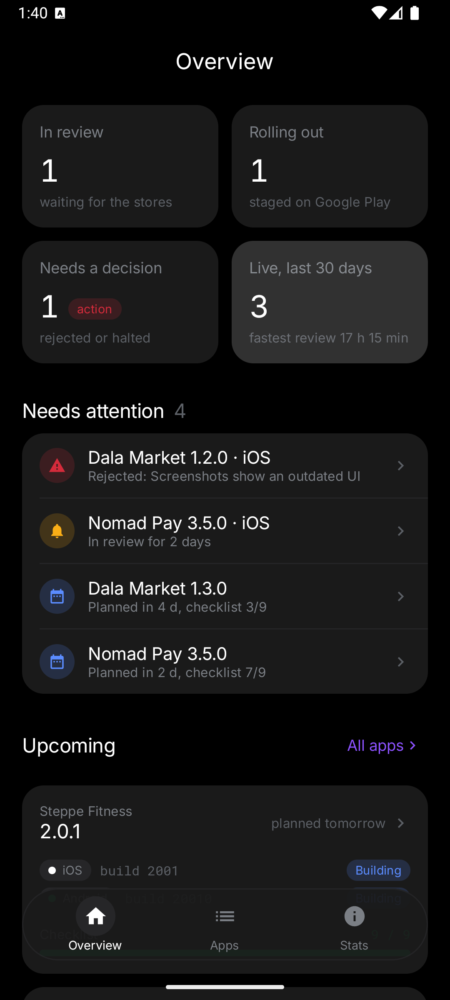
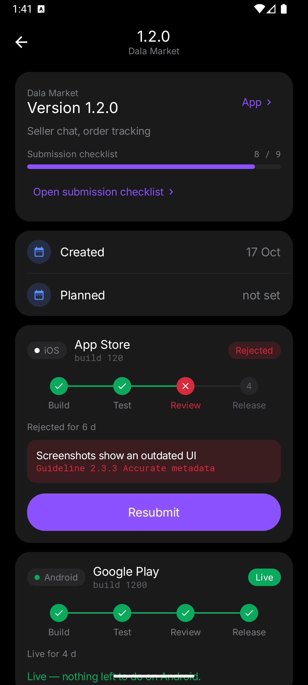
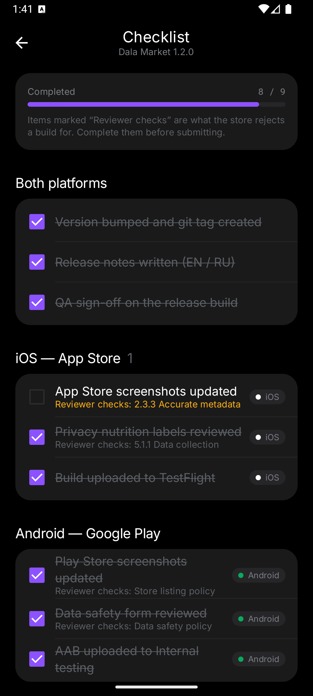
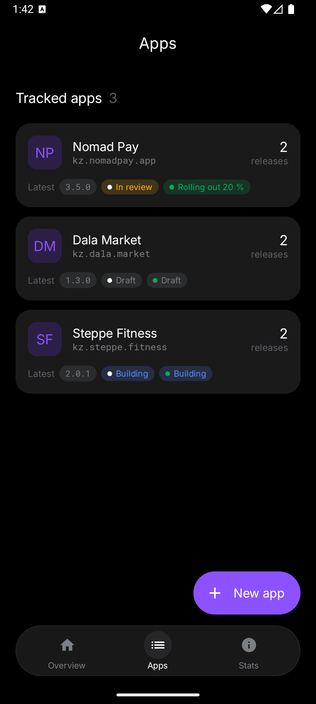
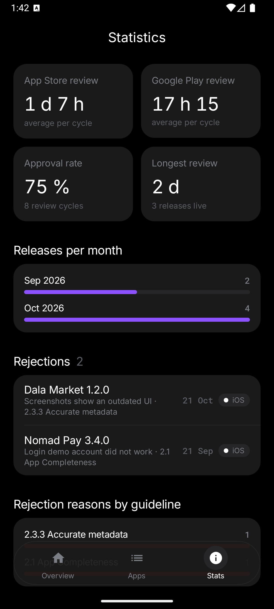

# ReleaseFlow — Midterm Project (Part 1)

Mobile Programming (KBTU, Fall 2026) · Android application with Kotlin, Jetpack Compose and Navigation Compose.

**ReleaseFlow** is a release tracker for mobile teams. Every app version goes through the same journey
on two platforms — build in CI, test in TestFlight / Internal testing, wait for the store review,
get rejected or approved, roll out in stages, go live — and in most teams this journey lives in chat
messages and the release manager's head. ReleaseFlow puts it on a board: where each version is on
each platform, what the reviewer rejected and why, what still has to be done before submitting, and
how long reviews actually take.

The author ships iOS and Android apps and runs their CI/CD and store operations, so the workflow,
the checklists and the rejection reasons in the demo data come from real practice.

## Features

| Feature | What the release manager can do |
| --- | --- |
| **Release workflow per platform** | Each release has an iOS and/or Android track with the stages `Draft → Building → Testing → Submitted → In review → Approved / Rejected → Rolling out → Live` (`Halted` for a paused rollout). The domain decides which actions are allowed from each stage; the screen only shows those buttons. Android supports staged rollout with a percentage slider; iOS releases in one step. |
| **CI and store checks (simulated)** | "Check CI status" and "Check review status" are `suspend` calls to a `StoreGateway`. Today it is a simulator with latency; in Part 2 the same interface is backed by GitLab, iTunes Lookup and App Store Connect APIs via Retrofit and polled by WorkManager. |
| **Submission checklist** | Every release gets a generated checklist (version bump, release notes, QA sign-off, screenshots, privacy labels / data safety, build upload). Items that map to a store guideline decide the outcome of the simulated review: an unchecked guideline item means a rejection citing that guideline. Custom items can be added per platform. |
| **Dashboard** | Tracks in review, staged rollouts, problems that need a decision, releases gone live in 30 days, a "Needs attention" list (rejections, halted rollouts, reviews longer than 2 days, releases due within a week with an unfinished checklist), upcoming releases and an activity feed. |
| **Statistics** | Average review time per store, approval rate, longest review, releases per month and the rejection log grouped by guideline — all computed from the stage histories. |
| **Apps and releases management** | Add apps (bundle id / package suggested from the name), create releases with version validation, planned date and per-platform build numbers; full stage history per release. |

## Screens and navigation

```
Dashboard ────────── release/{id} ──┬── release/{id}/checklist
Apps ──── app/{id} ──┬── app/{id}/new ──► release/{id}   (form is replaced by the new release)
                     └── release/{id}
Stats
```

Three top-level destinations in the bottom `NavigationBar`; `app/{appId}`, `app/{appId}/new`,
`release/{releaseId}` and `release/{releaseId}/checklist` are detail routes with typed `Int`
arguments. The back arrow in the top bar appears automatically on non-top-level screens.

## Screenshots

| Dashboard | Release workflow | Checklist |
| --- | --- | --- |
|  |  |  |

| Apps | Statistics |
| --- | --- |
|  |  |

## How to run

1. Android Studio Ladybug (2024.2) or newer with **Android SDK Platform 35** installed.
2. `File → Open…` → this folder (`midterm-project`). Wait for the Gradle sync (the wrapper downloads
   Gradle 8.9 and the dependencies on the first run).
3. Start an emulator (API 26+) or connect a device and press **Run ▶**.

```bash
./gradlew assembleDebug   # app/build/outputs/apk/debug/app-debug.apk
./gradlew installDebug    # install on the running emulator/device
```

The app starts with demo data: three apps and six releases in different states (one in review for
two days, one rejected for screenshots, one rolling out at 20 %, one building right now, two live),
so every screen has something to show.

Suggested walk-through: open **Dala Market 1.2.0** from "Needs attention" → the iOS track is rejected
for screenshots → open the checklist, tick "App Store screenshots updated" → back, **Resubmit** →
**Check review status** twice (In review → Approved) → **Release**. Then open **Nomad Pay 3.5.0** and
move the Android rollout from 20 % to 100 %.

## Architecture

```
┌──────────────── UI layer ─────────────────┐   ┌──── data layer ─────┐   ┌──────── domain ─────────┐
│ MainActivity                              │   │                     │   │ (pure Kotlin)           │
│  └ ReleaseFlowApp (Scaffold + NavHost)    │   │ ReleaseRepository   │   │ Platform, ReleaseStage  │
│      ├ screens/*   (stateless screens)    │◄──│  StateFlow<Release- │◄──│ MobileApp, Release,     │
│      └ components/* (reusable widgets)    │   │  Data>, commands    │   │ PlatformTrack, Checklist│
│ ReleaseViewModel ─ StateFlow<ReleaseUiState>│─►│  StoreGateway ──────│──►│ ReleaseService, Stats   │
└───────────────────────────────────────────┘   └─────────────────────┘   └─────────────────────────┘
```

- **Domain** (`domain/`): `sealed class ReleaseStage` with the workflow rules (`allowedActions`),
  mutable `PlatformTrack` / `Release` with encapsulated history, `ReleaseService` (validation, stage
  transitions, checklist template), `StoreGateway` interface + `SimulatedStoreGateway` (`suspend`),
  `ReleaseStats` (review durations, approval rate, rejections). No Android imports — compiled and
  exercised in a plain JVM test before the UI existed.
- **Data** (`data/ReleaseRepository.kt`): single source of truth. Owns the domain objects and publishes
  an immutable `ReleaseData` snapshot through a `StateFlow` after every command. Room and the real
  APIs plug in here in Part 2 without changes to the UI layer.
- **ViewModel** (`ui/ReleaseViewModel.kt`): mirrors the repository into `ReleaseUiState`, converts the
  mutable domain objects into immutable UI models (`ReleaseUi`, `TrackUi`, `AppUi`), tracks which
  tracks are waiting for an external system (`processing`), runs those calls in `viewModelScope`, and
  turns domain validation errors into snackbar messages. Exposes one `StateFlow<ReleaseUiState>`.
- **UI** (`ui/`): `ReleaseFlowApp` creates the ViewModel *above* the `NavHost` (Activity scope, shared
  by all screens), collects state with `collectAsStateWithLifecycle()` and owns all navigation calls.
  Screens are stateless functions of `ReleaseUiState` + callbacks; everything under `ui/components`
  is reusable and has no idea where its data comes from.

## Where the requirements are demonstrated

| Requirement | Where |
| --- | --- |
| ≥ 3 functional screens with Navigation Compose | 7 destinations in `ReleaseFlowApp.kt` / `ui/navigation/Routes.kt`; typed arguments via `navArgument(... NavType.IntType)`; bottom bar uses `popUpTo(startDestination) { saveState } + launchSingleTop + restoreState`; the "new release" form is popped with `popUpTo(NEW_RELEASE) { inclusive = true }` |
| ≥ 3 meaningful features | per-platform release workflow, checklist-driven store review, dashboard with attention list, statistics, app/release management |
| Material 3, reusable composables, consistent styling | `ui/theme` (custom color scheme, typography); `StageBadge`, `PlatformChip`, `AppMonogram`, `TrackTimeline`, `ReleaseCard`, `AppCard`, `ChecklistRow`, `ChecklistProgress`, `ActivityRow`, `StatCard`, `BarRow`, `SummaryRow`, `SectionTitle`, `ChoiceChipRow<T>`, `EmptyState`, `TextInputDialog`, `AddAppDialog`, `RolloutDialog` |
| User input, event handling, interactive state | forms with validation (version regex, date, platforms), checkboxes, chips, slider, dialogs, FABs, workflow buttons — every event is a ViewModel method |
| `remember`, `rememberSaveable`, state hoisting | `remember { SnackbarHostState() }`, `rememberNavController()`; `rememberSaveable` for every draft form field, open dialogs, dialog text and the rollout slider; all components receive value + callback |
| ViewModel with StateFlow and lifecycle-aware collection | `ReleaseViewModel.uiState: StateFlow<ReleaseUiState>`, collected once with `collectAsStateWithLifecycle()` |
| Separation of UI, logic and state | UI (`screens`, `components`) → ViewModel (events, UI state) → Repository (commands, snapshots) → Domain (rules, `StoreGateway`); no layer reaches past its neighbour |
| Kotlin classes, collections, functions, coroutines | `sealed class ReleaseStage` + exhaustive `when` everywhere, `enum class` with properties, `data class`, `interface StoreGateway`, extension functions (`Long.durationText()`), higher-order `ChoiceChipRow<T>`; `groupingBy().eachCount()`, `associateBy`, `flatMap`, `sortedByDescending`, `average`; `suspend` functions + `viewModelScope.launch` + `StateFlow` |
| Correct behaviour during configuration changes | ViewModel keeps data and in-flight operations; `rememberNavController()` restores the back stack; `rememberSaveable` restores forms, dialogs and the slider; a running CI/store check keeps running and its spinner reappears after rotation |

## Part 2 roadmap

- **HW3 / Room**: `AppEntity`, `ReleaseEntity`, `PlatformTrackEntity`, `StageEventEntity`,
  `ChecklistItemEntity`; DAO `Flow`s feed the same `ReleaseRepository`.
- **HW4 / Retrofit + WorkManager**: real `StoreGateway` implementations — iTunes Lookup (public, marks
  a track Live when the store shows the new version), GitLab Pipelines API (marks the build tested),
  App Store Connect API (exact review states); a periodic `SyncWorker` with a network constraint and a
  notification on every stage change.
- **Endterm**: Hilt instead of the hand-written singleton, `SavedStateHandle` for drafts, widgets.
